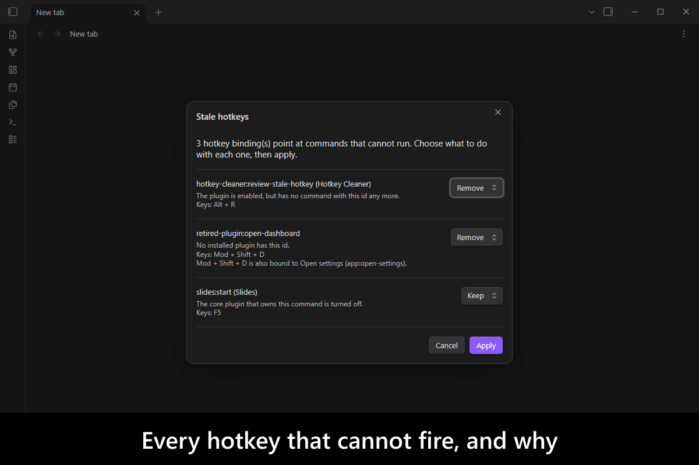
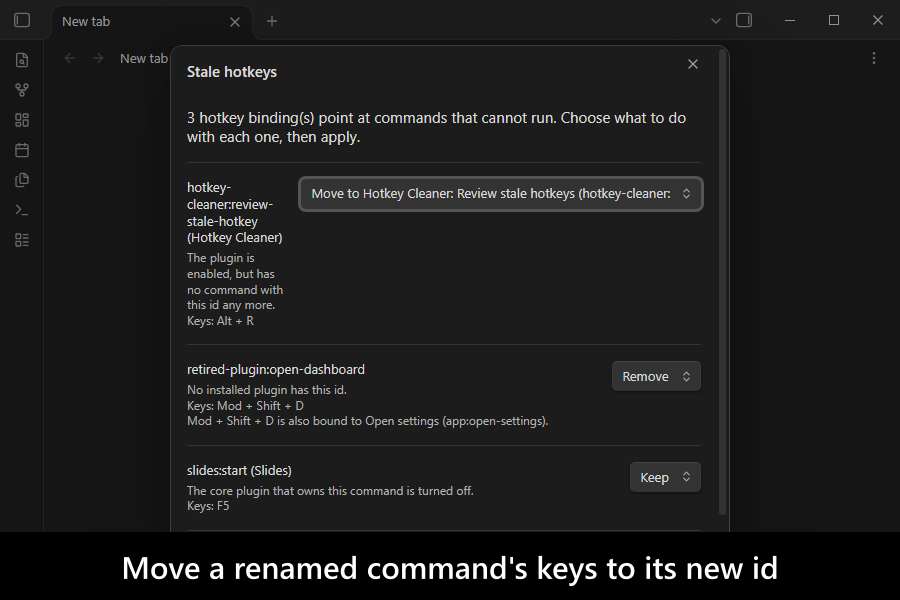

# Hotkey Cleaner

     

Finds hotkeys whose command no longer exists, and lets you remove, remap or keep each one.

Obsidian keeps every hotkey you assign in `hotkeys.json`, keyed by command id. When a plugin is uninstalled, or renames a command, its bindings stay behind, and the Hotkeys tab cannot show them because it lists only commands that exist. A stale binding can still hold a key another command wants.

Run **`Hotkey Cleaner`: Review stale hotkeys**. It checks every binding against the commands Obsidian has actually registered, and lists the ones that cannot fire: a plugin that is not installed, a command an enabled plugin no longer has, and a plugin or core plugin that is turned off. For each one you choose **Remove**, **Keep**, or **Move** its keys to the command it was most likely renamed to. Nothing is written until you press **Apply**. With **Check on startup** on, a notice tells you when there is something to review.

## Demo vault

**The documentation is a demo vault.** Every feature has a note that explains what it does and why you would want it, with a button you can press to watch it happen.

**[Start reading here](<./demo-vault/00 Start.md>)** — it is plain markdown, so it works on `GitHub` with nothing installed.

A copy of the vault ships with every release. You can access it via any of the following:

1. Running the **`Hotkey Cleaner`: Open demo vault** command, on desktop. The command is not available on mobile, so use the next option there.
2. Downloading `hotkey-cleaner-demo-vault.zip` from the [Releases](https://github.com/mnaoumov/obsidian-hotkey-cleaner/releases). It unzips into a single `hotkey-cleaner-demo-vault-<version>` folder.
3. Browsing its source in [`demo-vault/`](./demo-vault/README.md) in this repository.

## See also

[My other Obsidian resources](https://mnaoumov.dev/obsidian/)

| Plugin | Features | How `Hotkey Cleaner` differs |
| --- | --- | --- |
| [`Advanced Hotkeys`](https://github.com/z10n-dev/obsidian-advanced-hotkeys) | Custom hotkeys for any command; override default hotkeys; export and import hotkey configurations | Complements it; removes or moves bindings whose command is gone instead of adding new ones; no export or import |
| [`Hotkey Helper`](https://community.obsidian.md/plugins/hotkey-helper) | Hotkey and settings buttons on plugin tabs; counts of assigned and conflicting hotkeys | Complements it; sees bindings to commands that no longer exist, which `Hotkey Helper` never counts |
| [`Hotkeys Cheatsheet`](https://community.obsidian.md/plugins/hotkeys-cheatsheet) | Searchable cheatsheet of assigned hotkeys; conflict and modified-from-default filters; export as a note or HTML | Complements it; lists only the bindings that cannot fire, and removes or moves them |
| [`Keyboard Analyzer`](https://community.obsidian.md/plugins/keyboard-analyzer) | Visual keyboard; duplicate detection; hotkey editor | Complements it; works on bindings whose command is gone, which its command index cannot see |

Last searched for similar plugins on 2026-11-24.

## Installation

The plugin is available in [the official Community Plugins repository](https://community.obsidian.md/plugins/hotkey-cleaner).

### Beta versions

To install the latest beta release of this plugin (regardless if it is available in [the official Community Plugins repository](https://community.obsidian.md) or not), follow these steps:

1. Ensure you have the [BRAT plugin](https://community.obsidian.md/plugins/obsidian42-brat) installed and enabled.
2. Click [Install via BRAT](https://intradeus.github.io/http-protocol-redirector?r=obsidian://brat?plugin=https://github.com/mnaoumov/obsidian-hotkey-cleaner).
3. An Obsidian pop-up window should appear. In the window, click the `Add plugin` button once and wait a few seconds for the plugin to install.

## Development checks

Run `npm run check` to run release checks and reproduce the Community directory scanner's findings locally with `check-plugin --scanner`. See [CONTRIBUTING](./CONTRIBUTING.md) for setup. The scanner needs network access and installs its linters on each run, which can take a few minutes.

## Debugging

By default, debug messages for this plugin (id: `hotkey-cleaner`) are hidden.

If you need to enable them refer to the [documentation](https://mnaoumov.dev/obsidian-lib/guides/debugging/).

## Changelog

All notable changes to this project will be documented in the [CHANGELOG](./CHANGELOG.md).

## Contributing

Contributions are welcome — see [CONTRIBUTING](./CONTRIBUTING.md) to get set up.

## Support

<!-- markdownlint-disable MD033 -->

<!-- markdownlint-enable MD033 -->

### Filing an issue (for AI agents and humans)

Open issues through the [issue forms](https://github.com/mnaoumov/obsidian-hotkey-cleaner/issues/new/choose), not as blank issues.

To report a bug from inside Obsidian, run the **`Hotkey Cleaner`: Report a bug** command. It opens the bug form with the plugin version, the Obsidian version and your operating system already filled in.

Filing from the CLI or the API (`gh issue create --body`, or an AI agent filing for you) skips the form, and `gh issue create --template` cannot load an issue form. In that case, open the matching form in [`.github/ISSUE_TEMPLATE/`](https://github.com/mnaoumov/obsidian-hotkey-cleaner/tree/HEAD/.github/ISSUE_TEMPLATE), copy every field as a `### <label>` heading in the form's order, and fill in each one. Always state the plugin version, the Obsidian version and your operating system.

## License

© [mnaoumov](https://github.com/mnaoumov/)
